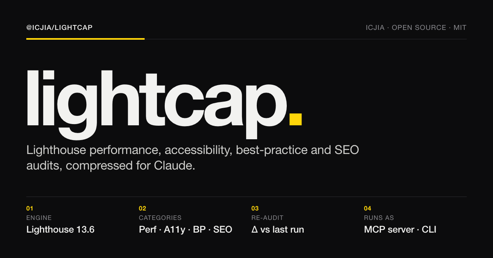

# @icjia/lightcap

[](https://www.npmjs.com/package/@icjia/lightcap)
[](LICENSE)


A lightweight local MCP server **and command-line tool** that runs Google Lighthouse audits and returns compressed, actionable results optimized for Claude's context window.

**New in 0.3: the `lightcap` CLI.** It does everything the MCP server does, so Claude (or any coding agent) can run audits from the shell without the MCP server installed. No server process per session, and it works in any agent with a shell. See [MCP or CLI?](#mcp-or-cli) and [How language models use the CLI](#how-language-models-use-the-cli).

## Why?

A raw Lighthouse report is ~2MB / ~500K tokens — it would destroy Claude's context window. LightCap compresses that into ~40-120 lines of structured plain text that Claude can read and act on immediately.

The workflow that matters:

```
You: "Run an accessibility audit on localhost:3000"
Claude: [calls run_a11y] Found 23 issues (4 critical, 8 serious, 11 moderate)
Claude: "I see 4 critical issues. Let me fix them now."
Claude: [edits your source files]
You: "Run it again"
Claude: [calls run_a11y] Found 11 issues (0 critical, 3 serious, 8 moderate)
```

This audit → fix → re-audit loop is what makes an MCP server more valuable than the Lighthouse CLI.

## What it does

- Runs full Lighthouse audits across performance, accessibility, best practices, and SEO
- Runs fast accessibility-only audits (~5s vs ~20s for a full audit)
- Compresses ~2MB Lighthouse JSON reports into ~40-120 lines of structured plain text
- Groups accessibility issues by impact level: critical, serious, moderate, minor
- Includes WCAG criteria references (e.g., WCAG 1.1.1, 1.4.3) and CSS selectors for each issue
- Filters to WCAG-only issues for compliance-focused audits (skips best-practice-only items)
- Reports core web vitals (FCP, LCP, TBT, CLS, Speed Index) with pass/fail indicators
- Shows which resources are implicated in performance issues, with wasted bytes/ms per file
- Prepends a `Δ vs last run` line on re-audits: score deltas, fixed issues, new issues
- Surfaces Lighthouse runtime errors (page failed to load, blocked, etc.) instead of silent zero scores
- Optionally saves full HTML reports to disk for manual human review
- Reports server and Lighthouse version info with npm update availability
- Standalone CLI with full MCP parity (macOS + Linux), so Claude can audit without the MCP server installed
- Runs as a local MCP server over stdio (no HTTP, no ports, no remote attack surface)

## MCP or CLI?

LightCap runs two ways, and both produce **the same compressed text output** from the same code (`runner.js` + `compress.js` + `diff.js`):

- **MCP server**: Claude calls `run_audit`, `run_a11y` and `get_status` directly. Registering it means a server process is started for every session, and the client has to load its tool definitions (Claude Code loads them on demand; some clients load every definition up front).
- **CLI**: Claude (or you) runs `lightcap a11y <url>` through the shell. No server registration and nothing running between audits. It works the same on macOS and Linux, and in any agent that can run shell commands.

You can run both, or uninstall the MCP server and rely on the CLI alone (see [Using the CLI instead of the MCP server](#using-the-cli-instead-of-the-mcp-server)).

### Why the CLI exists

lightcap started as an MCP server, and that's still a great way to run it. But a registered MCP server has a standing cost, and how big it is depends on the client:

- **Clients that load every tool definition up front** send `run_audit`, `run_a11y` and `get_status`, with their schemas and descriptions, to the model in every session, whether or not you audit anything that day.
- **Claude Code** defers MCP tool definitions: until a tool is needed, the model sees little more than its name. So in Claude Code the token saving from dropping the server is small.

What doesn't depend on the client: a registered server starts a process with every session, and it only works in MCP clients. The CLI has neither cost. It is the same code producing the same compressed report, run as a shell command only when an audit is needed, in any agent that has a shell (Claude Code, Codex, Cursor's agent, Aider) or in a script or CI job.

### Feature parity

Everything the MCP server does, the CLI does too, as of v0.3.0.

| Capability | MCP tool / parameter | CLI command / flag |
|---|---|---|
| Full audit | `run_audit` | `lightcap audit <url>` |
| Categories | `categories: [...]` | `-c, --categories performance,seo` |
| Top N per category | `maxIssues` | `-n, --max-issues <n>` |
| Mobile viewport | `viewport` | `-v, --viewport mobile` |
| Save HTML report | `directory` | `-d, --directory <path>` |
| Accessibility-only audit | `run_a11y` | `lightcap a11y <url>` |
| Top N per impact group | `maxIssues` | `-n, --max-issues <n>` |
| WCAG-tagged issues only | `wcagOnly` | `--wcag-only` |
| `Δ vs last run` on re-audits | automatic, per MCP session | automatic, saved between runs (`--no-diff` to skip) |
| Versions + update check | `get_status` | `lightcap status` (or `lightcap --version`) |
| Logging | `--verbose` / `--quiet` server args | `--verbose` / `--quiet` (any position) |

**Known differences** (none affect audit results):

- **Re-audit history:** the MCP server keeps it in memory, so it resets when the session ends. The CLI saves it to `~/.cache/lightcap/cli-history.json` (or `$XDG_CACHE_HOME/lightcap/…`, or wherever `LIGHTCAP_HISTORY` points). The file holds only scores and failed-audit IDs per URL/viewport/category set, for the last 20 targets, and is readable only by you. Either way, re-auditing the same target prints the same `Δ vs last run` line.
- The MCP server checks npm for a newer Lighthouse once at startup; `lightcap status` checks when you run it.
- The CLI writes progress logs (`[lightcap] ...`) to stderr. Add `--quiet` to keep Claude's Bash output down to the report itself.
- SSRF protection, URL validation, the output-directory boundary, the audit queue, timeouts and error sanitization are shared code, so the two modes enforce exactly the same limits.

## Installation

### Prerequisites

- **Node.js >= 22.19** (check with `node --version`; required by Lighthouse 13)
- **Google Chrome** or **Chromium** installed on your system
- **Claude Code**, **Cursor**, or any MCP-compatible client (for MCP mode)

### Option 1: npx (recommended, no install needed)

npx downloads and runs the package automatically. Nothing to install globally.

```bash
# Test that it works
npx -y @icjia/lightcap --help
```

### Option 2: Global install

```bash
npm install -g @icjia/lightcap
```

### Option 3: Clone for development

```bash
git clone https://github.com/ICJIA/lightcap-mcp.git
cd lightcap-mcp
npm install
```

## Setup with Claude Code

Claude Code manages MCP server lifecycle automatically — you register the server once, and Claude Code starts/stops it with each session.

### Using npx (recommended)

```bash
# Register for all projects (user-level)
claude mcp add lightcap -s user -- npx -y @icjia/lightcap

# Or register for current project only
claude mcp add lightcap -s project -- npx -y @icjia/lightcap
```

### Using a local clone

```bash
# Point directly at the source (for development)
claude mcp add lightcap -s user -- node /absolute/path/to/lightcap-mcp/src/server.js
```

### Manual config (edit settings.json directly)

If you prefer, edit `~/.claude/settings.json`:

```json
{
  "mcpServers": {
    "lightcap": {
      "command": "npx",
      "args": ["-y", "@icjia/lightcap"]
    }
  }
}
```

### Verify it's registered

Restart Claude Code after registering. You should see lightcap listed when you run `/mcp` in Claude Code. Then test:

> "Use lightcap to run an accessibility audit on http://localhost:3000"

### Tool routing with viewcap and Chrome MCP

If you have viewcap and Chrome MCP registered alongside lightcap, add this to your project's `CLAUDE.md` to ensure Claude uses the right tool for each task:

```markdown
# Tool preferences
- For Lighthouse audits (performance, accessibility, SEO), use the `lightcap` MCP server (run_audit, run_a11y, get_status).
- For all screenshots, use the `viewcap` MCP server (take_screenshot, capture_selector, take_screencast).
- For version info on MCP tools, use the relevant server's `get_status` tool.
- Use Chrome MCP for browser automation, DOM interaction, and navigation only.
```

## Setup with Cursor

Cursor supports MCP servers through its settings. Add lightcap to your Cursor MCP configuration.

### Global configuration

Edit `~/.cursor/mcp.json` (create it if it doesn't exist):

```json
{
  "mcpServers": {
    "lightcap": {
      "command": "npx",
      "args": ["-y", "@icjia/lightcap"]
    }
  }
}
```

### Project-level configuration

Create `.cursor/mcp.json` in your project root:

```json
{
  "mcpServers": {
    "lightcap": {
      "command": "npx",
      "args": ["-y", "@icjia/lightcap"]
    }
  }
}
```

After adding the configuration, restart Cursor. LightCap's tools will be available to the AI assistant.

## Setup with other MCP clients

LightCap works with any MCP client that supports stdio transport. The server communicates over stdin/stdout using JSON-RPC (the MCP protocol). Configure your client to spawn:

```bash
npx -y @icjia/lightcap
```

No HTTP ports, no environment variables, no API keys required.

## MCP Tools

### `run_audit`

Full Lighthouse audit across selected categories. Runs all four categories by default, returns compressed scores, top failed audits per category, and core web vitals metrics.

| Parameter | Type | Default | Description |
|-----------|------|---------|-------------|
| `url` | string | *(required)* | HTTP/HTTPS URL to audit |
| `categories` | string[] | all 4 | Which categories: `performance`, `accessibility`, `best-practices`, `seo` |
| `maxIssues` | number | 5 | Top N failed audits per category (max 15) |
| `viewport` | string | `desktop` | `desktop` or `mobile` |
| `directory` | string | — | Save full HTML report to this directory |

**Returns:** Compact structured text with scores, failing metrics, and top issues. Zero tokens wasted on passing audits or metrics.

**Example output (page with issues):**

```
http://localhost:3000 [desktop] Perf:72 A11y:88 BP:95 SEO:91
Failing metrics: LCP=4.2s CLS=0.12

── Perf (5 issues) ──
  ✗ largest-contentful-paint: 4.2 s
  ✗ unused-css-rules: Reduce unused CSS
    → main.css (48KB wasted), vendor.css (12KB wasted)
  ✗ render-blocking-resources: Eliminate render-blocking resources
    → styles.css (300ms), app.js (150ms)

── A11y (2 issues) ──
  ✗ image-alt: 12 images missing alt text
    → img.hero-image, img.card-thumb (×8) (+2)
  ✗ color-contrast: Insufficient contrast ratio
    → p.subtitle, span.caption (+5)
```

**Example output (clean page):**

```
http://localhost:3000 [desktop] Perf:98 A11y:100 BP:100 SEO:100
```

One line. ~30 tokens. No wasted context on a page that doesn't need fixing.

**Re-audit diff:** when the same URL is audited again in the same session (same tool, viewport, and categories), a delta line is prepended so Claude sees immediately what its fixes changed:

```
Δ vs last run: A11y 88→95 · fixed: color-contrast, image-alt · new: none
http://localhost:3000 [desktop] Perf:98 A11y:95 BP:100 SEO:100
...
```

**Runtime errors:** if the page fails to load (blocked, cert error, no content painted), the report says so instead of returning misleading zeros — unscored categories render as `?` and the Lighthouse error code and message appear under the header:

```
http://localhost:3000 [desktop] Perf:? A11y:? BP:? SEO:?
⚠ Audit error (ERRORED_DOCUMENT_REQUEST): Status code: 403 — results may be incomplete
```

### `run_a11y`

Accessibility-only audit. Faster than a full audit (~5s vs ~20s) and provides more detail on accessibility issues — grouped by impact level with WCAG criteria references and CSS selectors pointing to affected elements.

| Parameter | Type | Default | Description |
|-----------|------|---------|-------------|
| `url` | string | *(required)* | HTTP/HTTPS URL to audit |
| `maxIssues` | number | 10 | Top N failed audits per impact group (max 15) |
| `viewport` | string | `desktop` | `desktop` or `mobile` |
| `wcagOnly` | boolean | false | Only return issues with WCAG tags (filters out best-practice-only items) |
| `directory` | string | — | Save full HTML report to this directory |

**Returns:** Compact structured text with score, impact-grouped issues, WCAG refs, and CSS selectors. Critical/serious issues get full element detail; moderate/minor get compact detail.

**Example output:**

```
A11y: http://localhost:3000 [desktop] 88/100 — 9 issues (2c 3s 4m)

── Critical (2 issues, 20 el) ──
  ✗ image-alt [1.1.1] (12 el)
    → img.hero-image
    → img.card-thumb (×8)
    → img.logo
    → img.partner-logo (×2)
    → (+7)
  ✗ color-contrast [1.4.3] (8 el)
    → p.subtitle: foreground #999 on #fff = 3.2:1 (needs 4.5:1)
    → span.caption: foreground #aaa on #f5f5f5 = 2.8:1 (needs 4.5:1)
    → a.nav-link
    → (+5)

── Serious (3 issues, 6 el) ──
  ✗ heading-order [1.3.1] (1 el)
    → section.content > h4
  ✗ link-name [2.4.4] (3 el)
    → a.icon-link, a.social-fb, a.social-tw

── Moderate (4 issues, 11 el) ──
  ✗ list [1.3.1] (3 el)
    → li.breadcrumb-item (×3)
  ✗ tabindex [2.4.3] (2 el)
    → div.modal, input.search
  ✗ definition-list [1.3.1] (1 el)
    → dl.glossary
  ✗ duplicate-id-aria [4.1.1] (2 el)
    → nav#nav-main (×2)
```

**What the compact header tells you at a glance:**
- `88/100` — accessibility score
- `9 issues` — total failed audits
- `2c 3s 4m` — 2 critical, 3 serious, 4 moderate (impact shorthand)

**Tiered detail:** Critical and serious issues show up to 5 affected elements each (these are the ones you need to fix first). Moderate and minor show up to 3 (enough to understand the pattern without burning context).

**No silent drops:** every failed audit is grouped by impact — the `maxIssues` cap applies per impact group (with a `+N more` note), so a page with many failures can never have critical issues pushed out by moderate ones, and the header always counts the true total.

### `get_status`

Returns server and Lighthouse version info. This is the only way Claude can see version information — `console.error()` goes to stderr which Claude never reads.

| Parameter | Type | Default | Description |
|-----------|------|---------|-------------|
| *(none)* | — | — | No parameters |

**Returns:** Server version, installed Lighthouse version, latest available version on npm, Node version, platform.

**Example output:**

```
lightcap status
  Server:     @icjia/lightcap v0.2.0
  Lighthouse: v13.4.0 (latest)
  Node:       v22.22.0
  Platform:   darwin arm64
```

## CLI (standalone usage)

### Install the CLI from a clone (macOS + Linux)

```bash
git clone https://github.com/ICJIA/lightcap-mcp.git
cd lightcap-mcp
./install-cli.sh
source ~/.zshrc     # or ~/.bashrc, or open a new terminal
```

`install-cli.sh` is safe to re-run (after a `git pull`, for example). It:

1. Checks for Node 22.19+ (required by Lighthouse 13) and runs `npm install`.
2. Checks that Chrome or Chromium is installed. lightcap uses your system Chrome through chrome-launcher; set `CHROME_PATH` to use a specific binary. If none is found, it tells you what to install.
3. Adds a `lightcap` alias to `~/.zshrc` (and to `~/.bashrc` if you have one or bash is your login shell). The alias sits between `# >>> lightcap cli >>>` markers, so re-running replaces it instead of duplicating it.
4. Symlinks `~/.local/bin/lightcap` to `src/cli.js`. Aliases only load in interactive shells, so the symlink is what lets **Claude Code's Bash tool**, scripts and cron find `lightcap`. If `~/.local/bin` isn't on your `PATH`, the script tells you what to add.
5. Runs a test audit against a tiny page it serves on localhost, to prove Chrome launches and Lighthouse runs.

To remove the alias and symlink: `./install-cli.sh --uninstall`.

Prefer npm? `npm install -g @icjia/lightcap` installs the same `lightcap` command (no alias needed).

### Using the CLI instead of the MCP server

1. Install the CLI (above) and check it: `lightcap status`.
2. Remove the MCP server registration:

   ```bash
   claude mcp remove lightcap -s user     # or -s project / -s local, wherever you added it
   ```

3. Tell Claude about the CLI. Add this to `~/.claude/CLAUDE.md` (or a project `CLAUDE.md`):

   ```markdown
   - For Lighthouse audits, use the `lightcap` CLI via Bash (the MCP server is not installed):
     `lightcap --quiet audit <url>` (-c categories, -n max issues, -v mobile, -d dir),
     `lightcap --quiet a11y <url>` (--wcag-only), `lightcap status`.
     Output is compressed plain text; re-audits print a "Δ vs last run" line.
   ```

### How language models use the CLI

Once `lightcap` is on your `PATH` (or aliased), a model uses it exactly the way you would: it runs the command in its shell tool and reads the report from stdout. There is nothing to register. The model only needs to know the command exists, which is what the `CLAUDE.md` / `AGENTS.md` note above is for.

A typical session, with the commands the model runs on its own:

```bash
lightcap --quiet a11y http://localhost:3000
lightcap --quiet audit http://localhost:3000 -c performance,seo -v mobile
lightcap --quiet a11y http://localhost:3000 --wcag-only
lightcap status
```

What comes back is the same compact plain text the MCP tools return, small enough to read in full:

```
Δ vs last run: A11y 88→95 · fixed: color-contrast, image-alt · new: none
A11y: http://localhost:3000/ [desktop] 95/100 — 1 issues (1s)

── Serious (1 issues, 1 el) ──
  ✗ link-name [2.4.4] (1 el)
    → nav > a.icon-only
...
```

From there the model runs the usual loop: audit → read the issues → edit the code → re-run the same `lightcap` command, whose first line now reports what changed (`Δ vs last run`).

Tips for agents:

- **Use `--quiet`.** It keeps progress logs off stderr, so the model's context only holds the report.
- **Exit codes:** `0` on success, `1` on any error, with a single readable `Error: ...` line.
- **Other agents:** put the same note in whatever file your agent reads: `AGENTS.md` (Codex and others), `.cursor/rules`, `CONVENTIONS.md` (Aider), and so on.

  ```markdown
  - For Lighthouse audits, use the `lightcap` CLI via Bash:
    `lightcap --quiet audit <url>` (-c categories, -n <max>, -v mobile, -d <dir>),
    `lightcap --quiet a11y <url>` (--wcag-only). Re-audits print a "Δ vs last run" line.
    Output is compressed plain text. Run `lightcap <command> --help` for all flags.
  ```

### Setting up the alias by hand (zsh and bash)

`install-cli.sh` does this for you. To do it yourself, point an alias at `src/cli.js` in your clone. Replace `/path/to/lightcap-mcp` with the real path.

**zsh** (the default shell on macOS):

```bash
echo "alias lightcap='node \"/path/to/lightcap-mcp/src/cli.js\"'" >> ~/.zshrc
source ~/.zshrc
lightcap --version
```

**bash** (the usual default on Linux):

```bash
echo "alias lightcap='node \"/path/to/lightcap-mcp/src/cli.js\"'" >> ~/.bashrc
source ~/.bashrc
lightcap --version
```

On macOS, bash login shells read `~/.bash_profile` rather than `~/.bashrc`. If the alias doesn't appear in a new Terminal window, add `[ -f ~/.bashrc ] && . ~/.bashrc` to `~/.bash_profile`.

**Aliases vs. agents.** Shells only expand aliases in *interactive* sessions. A coding agent's shell tool may run commands non-interactively and never see the alias. That's why `install-cli.sh` also puts a real executable on your `PATH`. To do that by hand:

```bash
mkdir -p ~/.local/bin
ln -sf "/path/to/lightcap-mcp/src/cli.js" ~/.local/bin/lightcap
chmod +x "/path/to/lightcap-mcp/src/cli.js"
command -v lightcap    # should print ~/.local/bin/lightcap
```

(`~/.local/bin` must be on your `PATH`. Add `export PATH="$HOME/.local/bin:$PATH"` to your `~/.zshrc` or `~/.bashrc` if it isn't.) `npm install -g @icjia/lightcap` achieves the same thing without a clone.

### Commands

```bash
# Full audit
lightcap audit http://localhost:3000

# Accessibility-only audit
lightcap a11y http://localhost:3000

# Accessibility audit with WCAG-only filter
lightcap a11y http://localhost:3000 --wcag-only

# Audit specific categories
lightcap audit http://localhost:3000 -c performance,seo

# Mobile viewport
lightcap audit http://localhost:3000 -v mobile

# Save HTML report to directory
lightcap audit http://localhost:3000 -d ~/reports

# Top 10 issues per category
lightcap audit http://localhost:3000 -n 10

# Re-audit after a fix: the report starts with what changed
lightcap a11y http://localhost:3000
#   Δ vs last run: A11y 88→95 · fixed: color-contrast, image-alt · new: none

# Skip the diff (and don't record this run)
lightcap a11y http://localhost:3000 --no-diff

# Check versions
lightcap --version   # lightcap v0.3.0 (Lighthouse v13.x.x)
lightcap status      # also Node/platform, and checks npm for a newer Lighthouse

# Quiet output (no progress logs on stderr), handy when Claude runs it
lightcap --quiet a11y http://localhost:3000

# Verbose logging (flag position doesn't matter)
lightcap --verbose audit http://localhost:3000
```

The exit code is `1` on any error, so `lightcap` also works in scripts and CI.

Run with no arguments, `lightcap` starts the MCP server. MCP clients always launch it that way, with stdin piped. If you type plain `lightcap` at a terminal, it prints help instead of sitting there waiting for JSON-RPC. The help starts with the lightcap and Lighthouse versions, then lists the commands, examples and global flags.

## Usage examples

From Claude Code or Cursor, just ask naturally:

```
"Run an accessibility audit on localhost:3000"
"Audit localhost:3000 for performance and SEO"
"Run a11y audit on localhost:3000 with wcagOnly"
"Audit localhost:3000 and save the report to ~/reports"
"What version of lightcap is running?"
"Run a mobile audit on https://example.com"
"Audit localhost:3000 and show the top 10 issues per category"
"Fix all critical and serious accessibility issues, then re-audit"
```

## Compression strategy

The central design principle: **zero tokens on passes, maximum detail on failures.**

Every tool response must be small enough that Claude retains room to reason and act. A raw Lighthouse report is ~2MB / ~500K tokens. LightCap compresses that to ~30-1,200 tokens depending on the number of failures.

### Context window impact

| Scenario | Lines | Tokens (~) | vs. Raw JSON |
|----------|-------|------------|-------------|
| Clean page (no failures) | 1-2 | ~30 | 99.99% smaller |
| Page with 5 failures | ~15-25 | ~400 | 99.92% smaller |
| Heavy failure page (20+ issues) | ~60-120 | ~1,200 | 99.76% smaller |
| Raw Lighthouse JSON (NEVER returned) | ~60,000 | ~500,000 | — |

### How compression works

Lighthouse returns hundreds of audits. The compression engine applies 12 techniques:

1. **Failed audits only:** all passing audits are skipped entirely — zero tokens
2. **Failing metrics only:** passing metrics are dropped completely (was: all 5 shown with ✓/✗)
3. **Compact header:** URL, viewport, and all 4 scores on a single line: `http://localhost:3000 [desktop] Perf:72 A11y:88 BP:95 SEO:91`
4. **Short labels:** `Perf`, `A11y`, `BP`, `SEO`, `FCP`, `LCP`, `TBT`, `CLS`, `SI` instead of full names
5. **Top N issues per category:** default 5 (run_audit) or 10 (run_a11y), configurable up to 15
6. **Selector deduplication:** `img.card (×8)` instead of listing `img.card` eight times — saves tokens AND provides count information
7. **Selector truncation:** CSS selectors capped at 60 chars — `div.hero > img` not a 40-line DOM snippet
8. **Title compression:** `displayValue` preferred over verbose `title`; long titles truncated to 60 chars
9. **Impact grouping (a11y):** issues grouped by axe-core impact level (critical/serious/moderate/minor) with shorthand notation: `2c 3s 4m`
10. **Tiered element detail:** critical/serious issues show up to 5 affected elements; moderate/minor show up to 3 — detail where it matters most
11. **WCAG references:** extracted from Lighthouse's internal tags (e.g., `wcag111` → `1.1.1`)
12. **Hard cap:** output truncated at 200 lines with a notice to lower `maxIssues`

**What is never returned:** raw JSON, HTML reports, full audit trees, screenshot thumbnails, trace data, network request logs.

### Why plain text, not JSON?

JSON wastes tokens on syntax (`{`, `}`, `"key":`, quotes). Plain structured text is:
- ~30% fewer tokens than equivalent JSON
- Easier for Claude to scan and reference
- Still structured enough for Claude to reason about and act on

## Testing

```bash
# Run all tests (148 tests)
npm test

# Run a specific test file
node --test test/url-validation.test.js
```

The test suite covers:
- **URL validation** — scheme whitelist, blocking of file:/data:/javascript:/ftp: schemes, 0.0.0.0 and [::] blocking
- **Metadata endpoint blocking** — AWS (169.254.169.254), GCP (metadata.google.internal), Azure (metadata.azure.com)
- **IP blocking (behavioral)** — CIDR checks against real addresses: RFC1918 ranges, loopback, CGNAT, IPv6 unique-local beyond the fd00: literal (fd12::1), link-local tails (febf::1), IPv4-mapped IPv6, public addresses allowed
- **Directory validation** — path-separator containment (isWithin), symlink escapes, outside-root rejection, sibling-name rejection, HTML report saving
- **Audit queue** — serialization, depth cap rejection, recovery after task failure
- **Sanitization** — control char stripping, newline removal, zero-width char removal, prompt injection via newlines
- **Explanation truncation** — length cap at 120 chars, sanitization, null handling
- **Error sanitization** — known-safe passthrough, connection refused/timeout/DNS mapping, Chrome-not-found mapping, path leakage prevention
- **Compression** — compact header format, score extraction, failed-only filtering, failing-only metrics, honest capped headers, selector truncation/deduplication, perf resource labels with wasted bytes/ms, runtime error surfacing, output line + char limits, token estimation
- **A11y grouping** — impact level grouping, no silent drops beyond 15 failures, WCAG tag filtering (applied before capping), compact header with impact shorthand, element counts, tiered element detail
- **WCAG parsing** — 3-digit tags (wcag111 → 1.1.1), 4-digit tags (wcag1412 → 1.4.12)
- **Versions** — module-resolution-based Lighthouse version detection, npm output sanitization, status formatting
- **Session diff** — run summaries, delta lines (scores/fixed/new), LRU history eviction
- **Config sanity** — all numeric limits positive, default categories, metric thresholds, CIDR range well-formedness

## Local development

There is no build step. LightCap is plain JavaScript with ES modules. The source files are what ships to npm.

```
Edit source files
      |
      v
Restart Claude Code (re-spawns the server from source)
      |
      v
Test by talking to Claude Code ("audit localhost:3000")
      |
      v
See a bug? Edit the file, restart Claude Code, repeat.
```

### Quick development setup

```bash
# 1. Clone and install
git clone https://github.com/ICJIA/lightcap-mcp.git
cd lightcap-mcp
npm install

# 2. Register your local copy with Claude Code
claude mcp add lightcap -s user -- node $(pwd)/src/server.js

# 3. Restart Claude Code

# 4. Spin up a test target in another terminal
npx serve -l 3000 .

# 5. Test from Claude Code:
#    "Use lightcap to run an accessibility audit on http://localhost:3000"
```

After editing source files, restart Claude Code to pick up changes (the server is re-spawned fresh each startup).

## Architecture

```
src/
├── server.js ........... MCP server init + 3 tool registrations + session diff wiring
├── runner.js ........... Chrome launch + Lighthouse execution + URL/directory validation + bounded queue
├── compress.js ......... Report → compressed plain text (the core of the server)
├── diff.js ............. Session run history + Δ-vs-last-run lines
├── versions.js ......... Package/Lighthouse version detection + npm update check + status text
├── cli.js .............. Commander-based standalone CLI (audit, a11y, status; MCP parity)
├── cli-args.js ......... Pure argv helpers (global flags, server-vs-CLI dispatch)
├── cli-history.js ...... Persistent run history for CLI re-audit diffs
└── config.js ........... Constants, metric thresholds, CIDR blocklist, logging helper
```

| File | Role |
|------|------|
| `server.js` | MCP init, Zod schemas for 3 tools, request routing, error handling, re-audit diff lines |
| `runner.js` | `chrome-launcher` lifecycle, bounded audit queue, Lighthouse flags/config, URL validation (scheme whitelist, CIDR BlockList, metadata blocklist), directory validation (symlink-aware, separator-guarded) |
| `compress.js` | `compressFullReport()` — scores + failed audits + metrics + resource evidence; `compressA11yReport()` — impact grouping + WCAG refs + element dedup; runtime error surfacing |
| `diff.js` | `summarizeRun()`, `diffLine()`, `RunHistory` (LRU) for the audit → fix → re-audit loop |
| `versions.js` | `createRequire`-based Lighthouse version detection (works under npx flat installs), sanitized npm registry check, shared status block |
| `cli.js` | `audit`, `a11y`, `status` subcommands; starts MCP server mode on a bare invocation with piped stdin, prints help at a TTY |
| `cli-history.js` | Saves `summarizeRun()` results between CLI runs (owner-only JSON, LRU 20) so the CLI prints the same `Δ vs last run` line as the MCP tools |
| `install-cli.sh` | macOS/Linux installer: Node/Chrome checks, deps, `~/.zshrc`/`~/.bashrc` alias, `~/.local/bin` symlink, smoke test |
| `config.js` | `CONFIG` object with all limits/thresholds/CIDR ranges, `log(level, msg)` helper, `setVerbosity()` |

### Dependencies

| Package | Purpose |
|---------|---------|
| `@modelcontextprotocol/server` | MCP server SDK (stdio transport, tool registration) |
| `lighthouse` | Google Lighthouse library (Apache 2.0) |
| `chrome-launcher` | Launches Chrome for Lighthouse (controls lifecycle explicitly) |
| `commander` | CLI subcommand parsing |
| `zod` | Schema validation for MCP tool parameters |
| `@cfworker/json-schema` | Peer dependency of `@modelcontextprotocol/server` |

**Not needed (unlike viewcap):**
- No `puppeteer` — Lighthouse manages its own Chrome connection via DevTools Protocol
- No `sharp` — no image processing
- No restart wrapper — Lighthouse runs fresh Chrome per audit, no singleton to recover

## Security

LightCap runs locally over stdio — no network listener, no ports, no remote attack surface. Security mitigations focus on preventing misuse through prompt injection.

An adversarial red/blue team audit was conducted after the initial release. All critical and high findings were fixed in v0.1.4. See [CHANGELOG.md](CHANGELOG.md) for the full list.

### SSRF prevention

- **Scheme whitelist:** Only `http:` and `https:` URLs are allowed. `file://`, `data:`, `javascript:`, `ftp://`, and all other schemes are blocked.
- **Metadata endpoint blocklist:** AWS (`169.254.169.254`), GCP (`metadata.google.internal`), Azure (`metadata.azure.com`), `0.0.0.0`, and `[::]` are blocked by hostname.
- **CIDR range blocklist:** Resolved addresses are checked with Node's `net.BlockList` against proper CIDR ranges — RFC1918 (`10.0.0.0/8`, `172.16.0.0/12`, `192.168.0.0/16`), loopback (`127.0.0.0/8`, `::1/128`), "this network" (`0.0.0.0/8`), link-local (`169.254.0.0/16`, `fe80::/10`), CGNAT (`100.64.0.0/10`), IPv6 unique-local (`fc00::/7`), and unspecified (`::/128`). CIDR matching closes the string-prefix gaps (e.g., `fd12::1` is inside `fc00::/7` but does not start with the literal `fd00:`).
- **All resolved addresses checked:** DNS lookups use `{ all: true }` — a hostname with one public and one private record is blocked, not waved through on its first record.
- **IPv6-mapped IPv4 normalization:** Addresses like `::ffff:169.254.169.254` are normalized before checking.
- **Fail-closed DNS:** If hostname resolution fails or returns an unrecognizable address, the request is blocked (not allowed).
- **Post-audit URL recheck:** After Lighthouse completes, `lhr.finalDisplayedUrl` is validated against the same blocklist — catches HTTP redirect chains and DNS rebinding attacks. Fail-closed: if the final URL cannot be determined, the result is rejected.

### Prompt injection prevention

- **Output sanitization:** All page-controlled content (CSS selectors, audit titles, explanations) is stripped of control characters (C0/C1), newlines, zero-width chars, and BOM before being included in output. This prevents malicious pages from injecting adversarial instructions into Claude's context.
- **Explanation truncation:** `node.explanation` strings (e.g., color-contrast details) are capped at 120 characters.
- **Selector truncation:** CSS selectors are capped at 60 characters.
- **Character budget:** Total output is capped at 50,000 characters (in addition to the 200-line cap) to prevent long individual lines from inflating token usage.

### Directory traversal prevention

- Output paths are validated against the user's home directory and `/tmp` only, with a path-separator guard (`/tmpfoo` and `/Users/name 2` are not within `/tmp` / `/Users/name`).
- The deepest existing ancestor directory is resolved via `realpathSync` **before** any new directories are created, preventing TOCTOU symlink swap attacks.
- After creation, the final path is re-verified against allowed roots (belt and suspenders).
- Report files are written with the `wx` flag and a random filename suffix, so a pre-planted symlink at the target path is refused rather than followed.

### Error message safety

- Error messages returned to the AI are sanitized through an allowlist. Known safe messages pass through; common error types (connection refused, timeout, DNS failure) are mapped to generic messages; unknown errors return `'Audit failed'` with details logged to stderr only.
- A missing Chrome/Chromium binary (the most common first-run failure) maps to an actionable message: `Chrome not found — install Google Chrome or set CHROME_PATH`.
- External URL logging writes hostname only (not full URL) to stderr, preventing token leakage from query parameters.

### Resource limits

| Resource | Limit | Enforced By |
|----------|-------|-------------|
| Audit execution | serialized — one Chrome at a time | runner.js (bounded queue) |
| Queued audits | 3 max pending; beyond that rejected fast with "Audit queue full" | runner.js (bounded queue) |
| Lighthouse audit timeout | 60s | runner.js (Promise.race + clearTimeout) |
| Page navigation timeout | 30s | Lighthouse maxWaitForLoad flag |
| URL length | 2048 chars | Zod schema |
| Directory path length | 500 chars | Zod schema |
| Issues per category | 15 max | Zod schema + compress.js |
| Elements per issue | 5 shown | compress.js (remainder counted) |
| Selector length | 60 chars | compress.js (sanitized + truncated) |
| Explanation length | 120 chars | compress.js (sanitized + truncated) |
| Output lines | 200 max | compress.js (truncated with notice) |
| Output characters | 50,000 max | compress.js (truncated with notice) |
| Chrome process | killed in finally (SIGKILL fallback) | runner.js |

### Input validation

- **MCP path:** All parameters validated by Zod schemas with enforced min/max bounds. URLs validated with `z.url().max(2048)`. Categories constrained to enum. `maxIssues` capped at 15. Directory paths capped at 500 chars.
- **CLI path:** Numeric inputs validated with bounds checking (`clampInt`). Categories filtered against allowed set in `runLighthouse()`.
- **Request serialization:** Audits are serialized through a shared bounded queue (one Chrome at a time, at most 3 pending), preventing concurrent Chrome process collisions and unbounded request pileups.

### No raw data exposure

Full Lighthouse JSON and HTML reports are **never** returned to Claude. HTML reports can only be saved to disk (for human review). The compression engine is the only path from Lighthouse results to Claude's context.

## Desktop throttling note

Desktop mode disables network and CPU throttling for accurate localhost audits. Performance scores will differ from Lighthouse CLI defaults, which apply simulated throttling. This is intentional — localhost audits benefit from unthrottled results that reflect actual server performance rather than simulated slow-network conditions.

Mobile mode uses Lighthouse's default mobile throttling (simulated slow 4G).

## Configuration flags

| Flag | Description |
|------|-------------|
| `--verbose` | Log audit timing, Chrome lifecycle, compression details, missing axe-core fields |
| `--quiet` | Log errors only |

## ICJIA-specific usage

### ADA Title II compliance

The audit → fix → re-audit loop is the primary workflow for accessibility remediation:

```
You: "Run a11y audit on localhost:3000"
You: "Fix all critical and serious issues"
You: "Run it again — did the score improve?"
```

The `wcagOnly` flag filters to WCAG-mapped issues only, skipping Lighthouse's best-practice recommendations that aren't compliance-relevant.

### Multi-site sweeps

For multiple web properties, you can request a sweep:

```
You: "Audit these URLs and give me a scorecard:
  - icjia.illinois.gov
  - researchhub.icjia.dev
  - accessibility.icjia.app
  ..."
```

Claude will call `run_audit` sequentially and compile a summary table. Context impact: ~40 lines per site.

### Pre-deploy checks

Add to your project's `CLAUDE.md`:

```markdown
# Deploy checklist
Before any deploy to production, run `lightcap run_a11y` against localhost
and verify 0 critical issues and accessibility score >= 90.
```

## Clean-room notice

This project's design is informed by Google Lighthouse's public documentation and output format. **This is an original implementation. No code from third-party Lighthouse wrapper packages is used.** Lighthouse itself is used as a library dependency (Apache 2.0 license).

## License

MIT. See [LICENSE](LICENSE).
